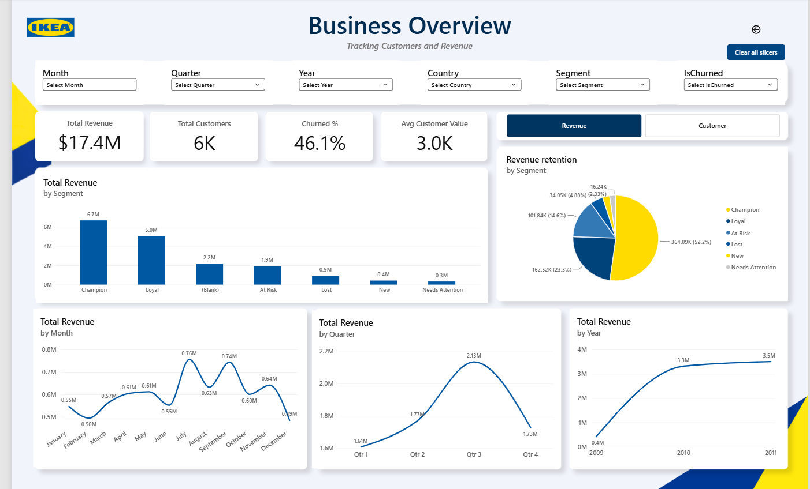
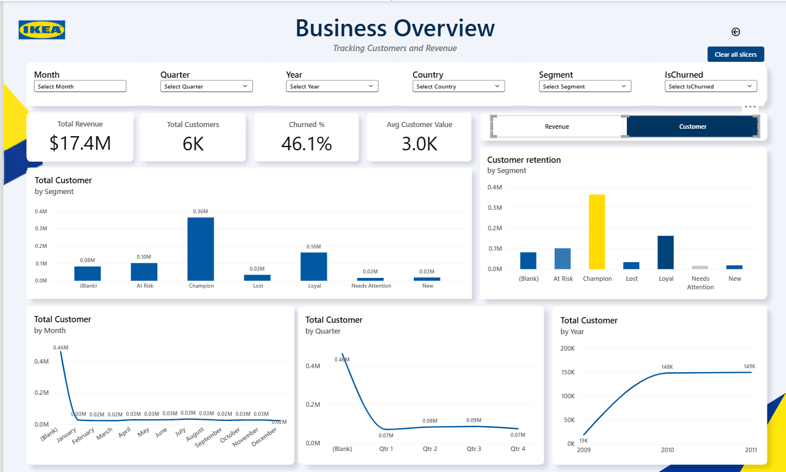
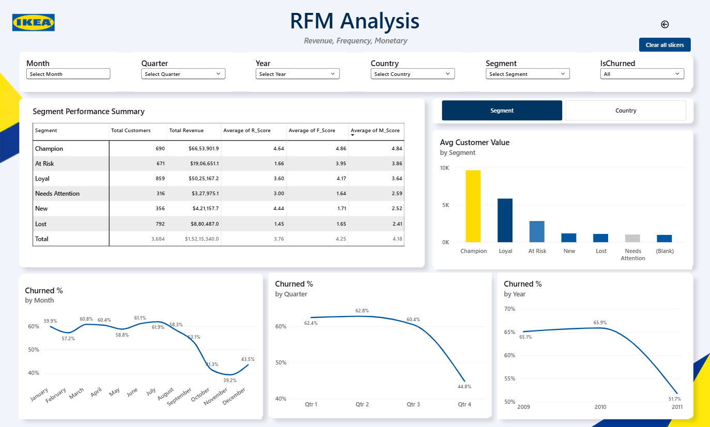
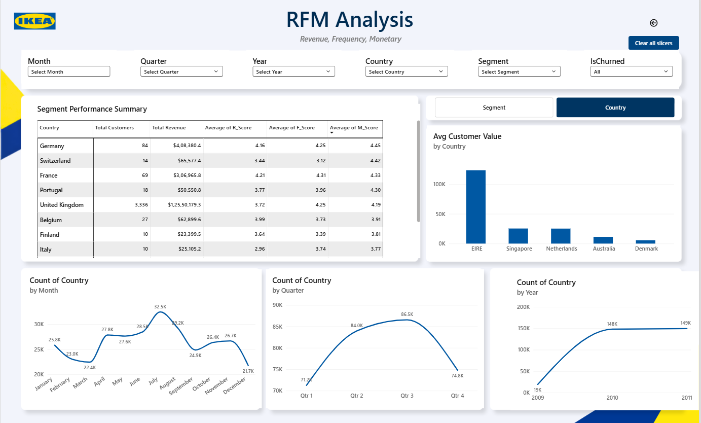

# IKEA Customer Analytics

An end-to-end retail customer analytics project using **SQL Server, Python (Pandas), and Power BI**. The project combines retail transaction data from two periods, performs data-quality checks and cleaning, and presents business performance and RFM customer segmentation in an interactive dashboard.

> **Dataset note:** The cleaned CSV used in the local workflow is approximately 111 MB, so it is not included in this repository. GitHub blocks ordinary files larger than 100 MiB. Keep the dataset locally or provide a legitimate source/download link if redistribution is permitted.

## Project objectives

- Combine the two retail transaction tables into one dataset.
- Convert date and price fields into appropriate SQL data types.
- Check missing customer IDs, non-positive quantities, missing descriptions, and duplicate records.
- Create a cleaned transaction table.
- Load and validate the cleaned CSV with Pandas.
- Analyze customer Recency, Frequency, and Monetary value (RFM).
- Explore revenue, customer counts, customer segments, and churn-related indicators in Power BI.

## Repository structure

```text
IKEA-Customer-Analytics/
├── README.md
├── .gitignore
├── sql
├── python
└── powerbi/
    └── screenshots/
        ├── 01_home_page.png
        ├── 02_business_overview_revenue.png
        ├── 03_business_overview_customers.png
        ├── 04_rfm_segment_analysis.png
        └── 05_rfm_country_analysis.png
```

## Tools used

- **SQL Server**  — database setup, combining tables, type conversion, data-quality checks, and deduplication.
- **Python** — Pandas for CSV loading, type conversion, and validation.
- **Power BI** — interactive business overview and RFM analysis pages.

## SQL workflow

Run the scripts in this order in a **test/development SQL Server environment**:

1. `sql/01_database_setup.sql` — creates the `IKEA_DB` database.
2. Import the two source sheets/tables as `dbo.[year2009-2010]` and `dbo.[year2010-2011]`.
3. `sql/02_combine_and_convert_data.sql` — creates `dbo.RetailCombined`.
4. `sql/03_data_quality_checks.sql` — checks data-quality issues.
5. `sql/04_create_cleaned_table.sql` — creates `dbo.RetailCleaned`.

**Important:** The database setup script drops and recreates `IKEA_DB` if it already exists. Do not run it against a database containing data you need. The SQL scripts assume that the two source tables have already been imported with the expected column names.

## Python workflow

Install the dependency:

```bash
pip install -r python/requirements.txt
```

Run the validation script, passing the path to your local cleaned CSV:

```bash
python python/load_and_check_data.py "C:/path/to/4.RetailCleaned results.csv"
```

The script treats `Invoice` as an identifier (string) and converts `InvoiceDate`, `Quantity`, `Price`, and `Customer_ID` to suitable types. It prints the dataset shape, data types, sample rows, and missing-value counts.

## Power BI dashboard

The dashboard contains:

- **Home page** — navigation to Business Overview and RFM Analysis.
- **Business Overview** — revenue, customer count, churn-related KPI, average customer value, and trends by segment, month, quarter, and year.
- **Customer view** — customer counts and retention by segment.
- **RFM Analysis** — segment performance, average RFM scores, customer value by segment/country, and churn-related trends.

### Dashboard previews










## Power BI file

Add your actual `.pbix` report to `powerbi/` before publishing if you want visitors to download and interact with the report. The screenshots in this repository are previews only; the `.pbix` file was not included in the files supplied for this project.

## Notes before publishing

- Confirm that you have permission to share the dataset and dashboard.
- Do not commit private, licensed, or customer-identifiable data.
- Do not upload the 111 MB CSV as a normal GitHub file. If sharing the data is permitted and necessary, consider Git Large File Storage (Git LFS), or link to the original public dataset instead.
- Review the SQL scripts and dashboard measures before describing any churn metric as confirmed churn. Inactivity-based churn is an analytical definition and should state its chosen time threshold.
